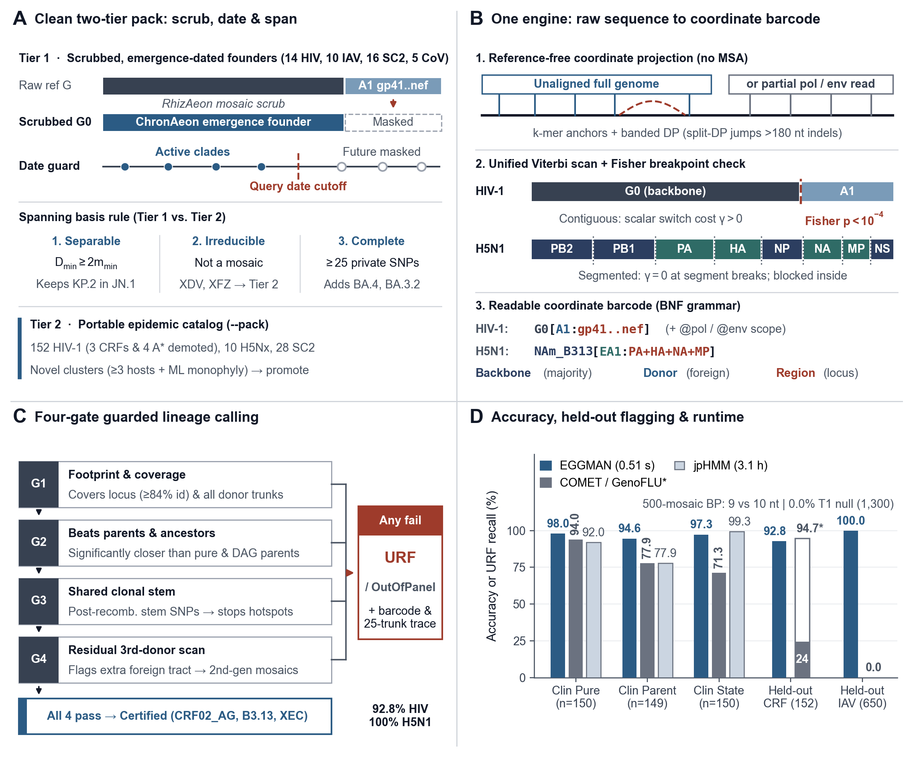
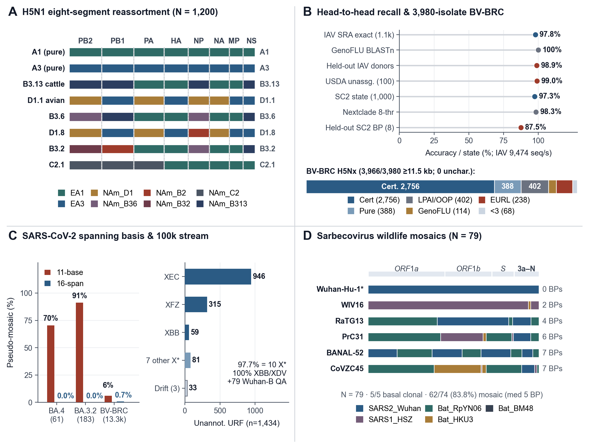
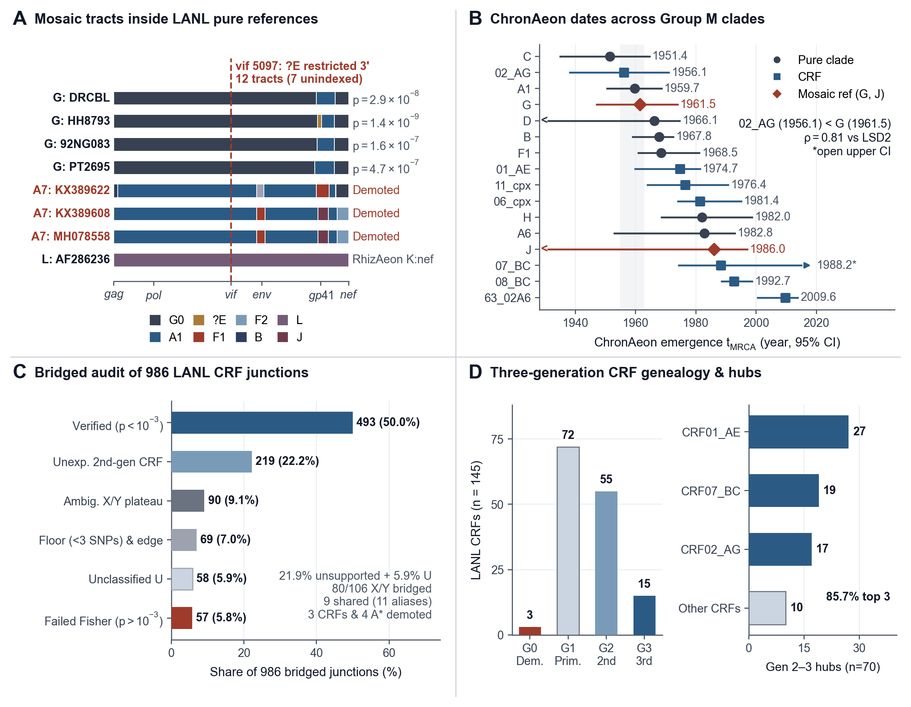
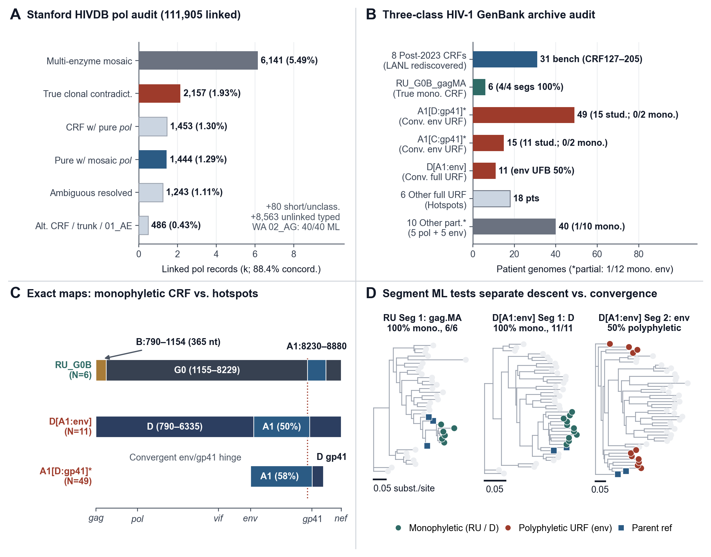
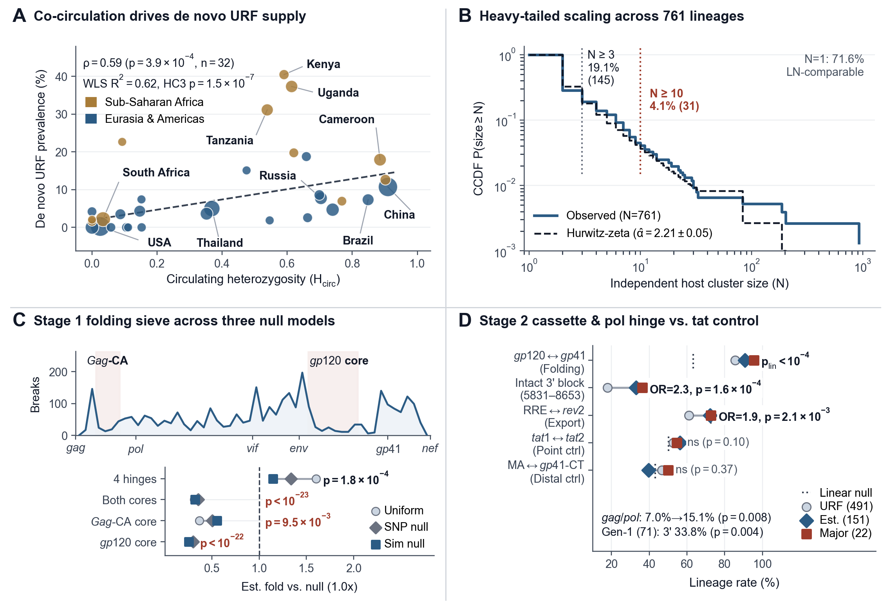

# EGGMAN

**E**xact **G**enomic **G**enealogy and **M**osaic **A**ncestry **N**omenclature

[](#installation--rust-cli)
[](https://veg.github.io/eggman/)
[](.github/workflows/ci.yml)
[](https://doi.org/10.5281/zenodo.24405743)

> *"Coordinate-anchored recombination, segment reassortment, and guarded lineage nomenclature across pandemic RNA viruses."*

**EGGMAN** (`v0.2.0`) is a native Rust (`eggman-core`, `eggman-cli`) and client-side WebAssembly (`eggman-wasm`) engine that decouples **Tier-1 invariant coordinate ancestry mapping** from **Tier-2 statistically guarded epidemic lineage certification**. Rather than collapsing novel recombinants or reassortants into arbitrary sequential integers (`CRF01`–`CRF157`, Pango `X*` aliases, or opaque `URF` tags), EGGMAN projects unaligned full genomes or partial clinical amplicons directly onto canonical reference coordinates, verifies crossovers or segment swaps with exact one-sided Fisher tests, and pairs deterministic coordinate barcodes (`Backbone[Donor:Region]`) with four-gate lineage calls and optional `ChronAeon` non-lookahead temporal guarding.

Through declarative **`PathogenSpec` profile packs (`--pack`)**, the identical compiled engine runs unmodified across **contiguous recombining viruses** (HIV-1 Group M, SARS-CoV-2, wildlife sarbecoviruses) and **multipartite segmented reassorting viruses** (eight-segment Influenza A H5Nx).

<p align="center">
  
</p>

---

## Multi-Pathogen Packs (`--pack`)

Every biological assumption—reference coordinates, landmarks, scrubbed emergence-weighted Tier-1 founders, segmentation switch rules, and Tier-2 catalogs—lives inside portable JSON/FASTA/TSV packs:

| Pathogen Pack | Coordinate Frame | Tier-1 Founders (Ancestry Basis) | Tier-2 Catalog (Epidemic Clades) | Switch Mode $\gamma(x)$ | Example Coordinate Barcode |
| :--- | :--- | :--- | :--- | :--- | :--- |
| **HIV-1 Group M** *(built-in default)* | Contiguous coding (`HXB2 790–9417`, `8,628 nt`) | `14` (`13` scrubbed pure trunks + `3'`-restricted `?E`) | `152` active callers (`171` catalogued: `142` LANL CRFs + `8` post-2023 + `Subtype_G` + `RU_G0B_gagMA`) | Constant scalar (default `7.0`) | `G0[A1:gp41..nef]` |
| [`packs/influenza_a_8seg`](packs/influenza_a_8seg) (`--pack iav`) | `8` concatenated ORFs (`PB2`–`NS`, `13,136 nt`) | `10` segment donors (`4` Eurasian `EA1–4`, `6` `NAm_*`) | `10` profiles (`2` pure `A1`/`A3` + `8` reassortants: `B3.13`, `D1.1`, `D1.3`, `B3.6`, `C2.1`, `B2.1`, `D1.8`, `B3.2`) | `0` at segment boundaries; `10^6` inside segments | `NAm_B313[EA1:PA+HA+NA+MP]` |
| [`packs/sars_cov2_wuhan`](packs/sars_cov2_wuhan) (`--pack sc2`) | Contiguous genome (`Wuhan-Hu-1`, `29,903 nt`) | `16` spanning waves (Spanning Basis Rule) | `28` profiles (`12` pure waves + `16` recombinants, e.g., `XBB`, `XDV`, `XEC`) | Constant scalar (default `7.0`; CoV-tuned `3.5`) | `BJ.1[BM.1.1.1:S..ORF10]` |
| [`packs/sarbecovirus_wuhan`](packs/sarbecovirus_wuhan) (`--pack sarbeco`) | Contiguous wildlife genome (`29,904 nt`) | `5` basal non-recombinant trunks (`SARS2`, `SARS1`, `3` bat) | Tier-1 coordinate mapping only | Constant scalar (deep recombination) | `SARS2_Wuhan[Bat_RpYN06:ORF1a+S+N..ORF10]` |

```bash
# Default HIV-1 Group M full genomes or partial pol/env amplicons (aligned or unaligned)
eggman query_hiv.fasta --out results.csv --json results.json

# 8-segment Influenza A H5Nx reassortment calling (accepts concatenated or raw 8-segment FASTAs)
eggman h5n1.fasta --pack iav --out flu_calls.csv

# Clinical SARS-CoV-2 surveillance with low-divergence coronavirus thresholds
eggman sc2.fasta --pack sc2 --gamma 3.5 --min-snps 3 --p-thresh 0.01

# Non-lookahead prospective surveillance using ChronAeon temporal guards (`sampled` or `submission`)
eggman stream.fasta --pack sc2 --temporal-guard --temporal-mode submission --out guarded.csv

# Natural bat/pangolin sarbecovirus genomes
eggman sarbeco.fasta --pack sarbeco --out sarbeco_calls.csv

# Export a self-contained JSON bundle for any built-in pack (`hiv1`, `iav`, `sc2`, `sarbeco`)
eggman --pack sc2 --export-pack sc2_bundle.json
```

---

## Core Architecture

1. **Reference-Free Seed-Chained Alignment & Split-DP**
   - Projects unaligned full genomes or partial amplicons directly onto canonical coordinates via bidirectional exact `15`-mer chaining (step `2`, collision probability $4^{-15} = 9.31 \times 10^{-10}$), `11`-mer fallback/rescue across divergent spans (`>350 nt`), and banded Needleman–Wunsch (`+2 / -1 / -3`, band `45`) against a 4-bit `A/C/G/T` reference-profile union mask (with query ambiguity codes skipped in Viterbi).
   - Large structural insertions or deletions (`|m - n| > 180 nt`) are bridged by a two-piece unit-diagonal split-DP solver (`STRUCT_BAND = 45`) rather than gap-smearing across neighboring genes; HIV-1 *pol* drug-resistance codons remain unmasked.

2. **Unified Tier-1 Viterbi Segmentation & Statistical Breakpoint Falsification**
   - Minimizes discrete unit-mismatch emission cost (`0.0` match, `1.0` mismatch, `0.35` gap/ambiguous reference, `0.58` `Unattributed` ghost, `2.0` domain mask; `?E` locked to `HXB2 5097–9417` with `0.035/site` offset) plus position-dependent switch cost $\gamma(x)$ (`7.0` default on contiguous genomes; `0.0` across segment boundaries and `10^6` inside segments on segmented packs).
   - Every proposed junction must pass minimum flanking length (`120 nt` full / `150 nt` partial / half-segment on segmented packs), minimum parent-discriminating SNPs (`5` default; `3` CoV-tuned), and a **one-sided upper-tail `2×2` Fisher's exact test** (`p < 1e-4` default). Verified paths render into deterministic BNF coordinate barcodes (`<backbone>(Clonal)` or `<backbone>[<donor>:<span_list>]@<scope>`).

3. **Four-Gate Tier-2 Certification, `OutOfPanel` Guards, & `ChronAeon` Temporal Masking**
   - Every Tier-2 epidemic call must pass four sequential falsification gates: **(1)** footprint coverage (`>=100 nt`, `>=84%` identity) and constituent donor plurality (`cw > bw` on `>=3` SNPs); **(2)** binomial dominance over every pure parental trunk and recombination-DAG ancestor (`>=5` SNPs full / `>=3` partial); **(3)** shared clonal post-recombination stem excess over composite parental expectation $B_c(x)$ (`>=8` HIV full / `>=5` HIV partial / `>=4` IAV / `>=2` SC2 full); and **(4)** an **all-excursion Kadane residual scan** (`>=80 nt`, net `>=12` full / `>=10` partial, `p < 1e-4`) catching hidden third-donor secondary tracts.
   - Gate failures fall back safely to `URF` (paired in HIV-1 with an interpretable **25-trunk epidemiological trace**: `13` pure basal trunks excluding `?E` plus `12` pandemic founder CRFs at `0.005/site`). Any Tier-1 segment (`>=80` valid nt) below the pack's `min_segment_identity` (`82%` HIV-1, `90%` IAV/SC2, `70%` sarbecovirus) or violating an active `--temporal-guard` floor routes cleanly to `OutOfPanel`.

---

## Key Manuscript Results & Figures

### 1. Cross-Family Benchmarks & Live Streaming Surveillance
Across `1,200` complete SRA H5N1 genomes (`~9,500 seq/s`), EGGMAN achieves **`97.8%` (`1,076/1,100`) exact genotype accuracy** across all `10` labeled genotypes (`0` cross-genotype misclassifications; `23 OutOfPanel` + `1 URF` safe abstentions), flags **`100%`** of `650` held-out `B3.13`/`D1.1` isolates (`98.9%` exact eight-segment donor formula vs. `100% Not_assigned` for `GenoFLU`), resolves `98%` of `100` USDA-unassigned isolates, and organizes `3,980` BV-BRC H5Nx assemblies in `7.3 s`. On SARS-CoV-2, the 16-founder Spanning Basis matches 8-thread `Nextclade CLI` on clonal-vs.-recombinant state (`97.3%` vs. `98.3%`, `99.4%` exact pure waves) while streaming `100,000` live BV-BRC genomes in under two minutes and blindly recovering `10` designated Pango `X*` roots (`97.7%` of clustered unannotated `URF`s):

<p align="center">
  
</p>

### 2. HIV-1 Reference Scrubbing, `ChronAeon` Dating, & Bridged LANL Breakpoint Audit
Reference-free `RhizAeon` scrubbing uncovers **12 foreign or divergent tracts inside 10 canonical LANL pure-subtype references** (including ancestral `G0[A1:gp41..nef]` in all four Subtype G references and `K:nef` in Subtype L), `ChronAeon` dates `CRF02_AG` (`1956.1`) ahead of Subtype G (`1961.5`, within overlapping CIs; $\rho = 0.814$ vs. `LSD2`, median diff. `12.72 yr`; $\rho = 0.791$ vs. `TreeTime`, median diff. `11.23 yr`), and auditing `986` bridged LANL CRF junctions shows **`50.0%` (`493`) verified elementary switches**, `22.2%` (`219`) unexpanded second-generation CRF labels, `5.9%` (`58`) untestable unclassified `U` segments, and `21.9%` (`216`, or `23.3%` of `928` indexed-donor junctions) statistically unsupported boundaries, while `85.7%` (`60/70`) of Generation 2–3 CRFs descend from `CRF01_AE`, `CRF07_BC`, and `CRF02_AG`:

<p align="center">
  
</p>

### 3. Stanford HIVDB Audit & Three-Class GenBank Archive Separation
Auditing `120,468` clinical Stanford HIVDB *pol* sequences separates `6,141` (`5.49%`) multi-enzyme mosaic splits from `2,157` (`1.93%`) intra-patient clonal contradictions (plus `80` short/unclassifiable fragments accounting for all `13,004` discrepancies) while typing `8,563` unlinked sequences. Across `31,825` full-length (`7,720` deduplicated hosts) and `38,250` strictly partial-only (`20,797` hosts) GenBank+LANL HIV-1 records, multi-segment `IQ-TREE 2` phylogenies cleanly separate **(i)** `8` blindly rediscovered post-2023 LANL CRFs, **(ii)** `1` strictly monophyletic full-genome regional candidate (`RU_G0B_gagMA`, $N = 6$, `4/4` segments `100%` UFBoot) plus `1/12` monophyletic partial-*env* cluster (`C[D:gp41]`, $N = 3$, Tanzania; full genome unavailable), and **(iii)** convergent polyphyletic hotspot URFs (`7` full-genome formulas led by East African `D[A1:env]` + `11/12` partial-gene hotspots, `101/104` partial patients):

<p align="center">
  
</p>

### 4. Ecological Co-Circulation Supply & Two-Stage Epistatic Fitness Sieve
Across `32` countries, circulating non-URF heterozygosity $H_{\mathrm{circ}}$ drives upstream *de novo* URF generation ($\rho = 0.59, p = 3.9 \times 10^{-4}$; WLS $R^2 = 0.62$, HC3 $p = 1.5 \times 10^{-7}$), while offspring cluster sizes (`N = 761` mosaic lineages) show a steep **heavy-tailed decline** (Hurwitz-zeta tail $\hat{\alpha} = 2.21 \pm 0.05$, comparable to discrete lognormal; invariant across `0.4%–1.5%` host deduplication). Comparing `491` singleton dead-end URFs against `151` established CRFs, `22` major CRFs, and `71` alias-collapsed Generation-1 primary founder CRFs separates a **Stage 1 within-host protein-folding sieve** (depleting breakpoints in `gp120` [`0.25–0.30×`] and `Gag-CA` [`0.36–0.55×`] cores across uniform, SNP-density, and `EGGMAN` detectability nulls) from a **Stage 2 between-host transmission sieve** preserving an undivided `3'` regulatory/Env cassette (`HXB2 5831–8653`: `17.9% → 33.1%` all Est [MV `OR = 3.09, p = 9.6 × 10^-6`] and `33.8%` Gen-1 primary CRFs [MV `OR = 2.58, p = 4.0 × 10^-3`], with `RRE↔rev2` reaching `81.7%` in Gen-1 founders [MV `OR = 2.67, p = 4.0 × 10^-3`]), whereas isolated `tat1↔tat2` point-exon co-ancestry is non-significant:

<p align="center">
  
</p>

---

## Interactive WebApp (Rust + WebAssembly)

- **Live Browser App:** **[https://veg.github.io/eggman/](https://veg.github.io/eggman/)**

Runs 100% client-side via compiled `wasm32` bindings ([`crates/eggman-wasm`](crates/eggman-wasm)) with zero data leaving the browser:
- Auto-detects pathogen packs (`hiv1`, `iav`, `sc2`, `sarbeco`) from raw sequence 15-mers, automatically stitches unconcatenated eight-segment Influenza A FASTAs, and supports custom `PathogenProfilePack` JSON import/export.
- Exposes live threshold presets (default, CoV 4-SNP, strict), **ChronAeon non-lookahead temporal guarding** (`sampled` / `submission` modes + optional query year), interactive coordinate paintbars, Fisher `2×2` contingency drawers, equivalent CLI preview, and CSV/JSON/SVG/HTML report export.

---

## Installation & Rust CLI

Requires Rust (`Edition 2021`, `cargo`).

```bash
git clone https://github.com/veg/eggman.git
cd eggman
cargo build --release
```

### Usage

```text
./target/release/eggman [OPTIONS] [INPUT_POS]

Arguments:
  [INPUT_POS]                      Positional FASTA path if --fasta is omitted

Options:
  -f, --fasta <FASTA>              Input FASTA file (aligned or unaligned, full-length or partial amplicon)
      --pack <PACK>                Pathogen pack (`hiv1`, `iav`, `sc2`, `sarbeco`, JSON bundle, or directory)
      --export-pack <PATH>         Export a self-contained PathogenProfilePack JSON bundle and exit
      --export-default-pack <PATH> Export the built-in HIV-1 Group M PathogenSpec manifest template and exit
  -o, --out <OUT>                  Output CSV file path for tabular results
      --json <JSON>                Output JSON file path for detailed segment/breakpoint/guard report
  -l, --limit <LIMIT>              Maximum sequences to process [default: 0 = all]
      --gamma <GAMMA>              Template-switch penalty gamma (mismatch units) [default: 7.0]
      --min-span <MIN_SPAN>        Minimum segment span in reference nt [auto: 120 full / 150 partial]
      --min-snps <MIN_SNPS>        Minimum diagnostic SNPs per flanking segment [default: 5]
      --p-thresh <P_THRESH>        One-sided upper-tail 2x2 Fisher exact p-value cutoff [default: 1e-4]
      --no-loop-mask               Disable hypervariable loop masking prior to segmentation
      --profiles <PROFILES>        Optional custom Tier-2 certified profiles TSV path
      --temporal-guard             Enable ChronAeon non-lookahead temporal donor/lineage guarding
      --temporal-mode <MODE>       Temporal floor mode (`sampled` or `submission`) [default: sampled]
      --query-year <YEAR>          Explicit decimal query year override (default: parsed from FASTA header)
      --temporal-slack-yr <YR>     Lookahead slack in years (default: pack setting in sampled; 0.0 in submission)
      --seg-mode <MODE>            Segmented FASTA grouping (`auto`, `single_isolate`, `per_record`) [default: auto]
  -q, --quiet                      Suppress per-sequence console report
  -h, --help                       Print help
  -V, --version                    Print version
```

### Testing & Rebuilding the WebAssembly Bundle

```bash
# Run all 54 workspace unit & integration tests
cargo test --workspace

# Rebuild docs/pkg WebAssembly assets (requires wasm-pack & wasm32-unknown-unknown target)
wasm-pack build crates/eggman-wasm --target web --out-dir ../../docs/pkg --no-pack
```

---

## Repository Structure

```text
eggman/
├── Cargo.toml                           # Workspace manifest (v0.2.0: eggman-core, eggman-cli, eggman-wasm)
├── Cargo.lock                           # Locked dependency graph
├── README.md                            # Documentation, figures, and cross-pathogen benchmarks
├── LICENSE                              # MIT License
├── crates/
│   ├── eggman-core/                     # Reference-anchored alignment, Tier-1/2 engines, ChronAeon/pack structs & tests
│   ├── eggman-cli/                      # Parallel rayon CLI binary (`eggman`) & integration tests
│   └── eggman-wasm/                     # Client-side WebAssembly bindings (`WasmEggman`)
├── packs/
│   ├── influenza_a_8seg/                # 8-segment Influenza A H5Nx reassortment pack (10 donors, 10 Tier-2 profiles)
│   ├── sars_cov2_wuhan/                 # Clinical SARS-CoV-2 16-wave spanning pack (16 founders, 28 Tier-2 profiles)
│   └── sarbecovirus_wuhan/              # Wildlife bat/pangolin sarbecovirus pack (5 basal trunks, 29,904 nt)
├── scripts/                             # Reproducible Python benchmarking, surveillance, sieve & figure scripts
├── docs/
│   ├── index.html                       # Zero-server interactive WASM WebApp
│   ├── worker.js                        # Background WebWorker WASM runner
│   ├── pkg/                             # Compiled wasm-pack bundle (`eggman_wasm_bg.wasm`)
│   ├── examples/                        # Built-in specimen FASTA files & standalone SC2 pack JSON
│   └── figures/                         # Manuscript figures (PNGs)
└── .github/workflows/
    ├── ci.yml                           # Automated workspace build, tests, & wasm32 check
    └── deploy-pages.yml                 # Automated GitHub Pages deployment from docs/
```
